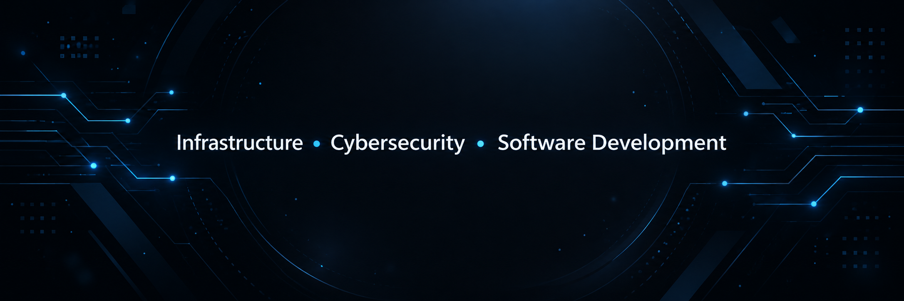

  

<h1 align="center">Hi, I'm Yan Pereira 👋</h1>

  <b>IT Infrastructure • Cybersecurity • Software Development</b>

  
  
  

---

## 👨‍💻 About Me

I'm a technology enthusiast based in Curitiba, Brazil, with hands-on experience in enterprise IT infrastructure, networking, monitoring, and automation.

I enjoy solving technical problems, understanding how systems work, and building practical solutions through software and infrastructure.

- 🖥️ Working with IT infrastructure, networking, and monitoring
- 🔐 Interested in cybersecurity, defensive security, and system administration
- 🐍 Building tools and automation with Python and PowerShell
- 🎮 Developing projects like **MATHBLOCK** with Unity and C#
- 🚀 Continuously improving through real-world technical challenges

---

## 🛠️ Tech Stack

  

### Infrastructure & Security
- Windows Server
- Linux
- Active Directory
- Hyper-V
- Networking
- Zabbix
- Wazuh
- Network Troubleshooting

---

## 🚀 Featured Projects

### **MATHBLOCK**
Educational game developed with **Unity** and **C#**, combining mathematics, gameplay, and interactive challenges.

### **Nódara**
Independent software project focused on **local tooling**, **automation**, and reliable application workflows.

---

## 🎯 Current Focus

- Strengthening my software engineering foundations
- Expanding my cybersecurity and infrastructure knowledge
- Building useful and well-documented projects
- Developing practical technical skills for real-world environments

---

## 📫 Connect with Me

- [LinkedIn](www.linkedin.com/in/yan-vinicius-793758351)
- [GitHub](https://github.com/Yanszpereira)
